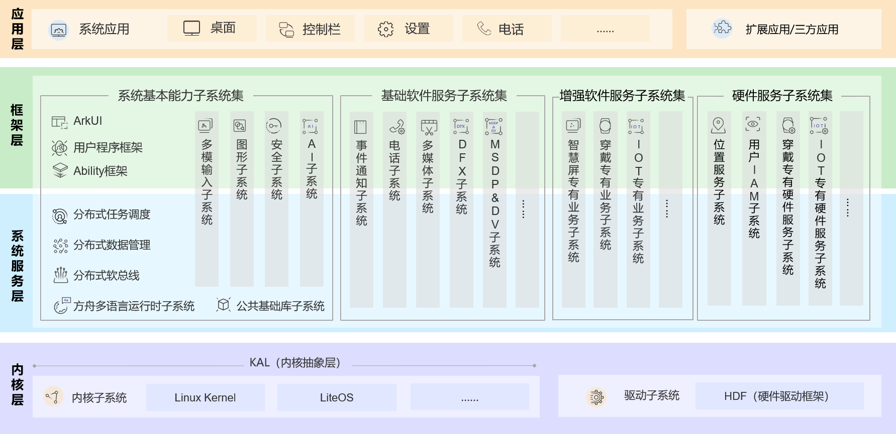

# OpenHarmony MINI 移植与 HDF 驱动开发技术说明书

| 项目 | 内容 |
|---|---|
| 文档编号 | OH-N32H7-MINI-TM-001 |
| 版本 | 1.1 |
| 适用系统 | OpenHarmony 6.1 mini（以 LiteOS-M 为内核） |
| 适用硬件 | N32H7xx EVAL（Cortex-M7 + CM4） |
| SDK 基线 | Nations N32H7xx Library 1.3.0 |
| 文档性质 | 技术说明书。描述系统构成、构建方式、启动链、HDF 框架规范、驱动开发规范、测试与调试方法 |
| 修订记录 | 1.0 首版。统一行文体例与术语；补充 I2C 地址在各层的取值与变换关系；补充失效模式索引与检查清单<br>1.1 补充 OpenHarmony 项目概述、总体技术架构（含架构图）与系统类型定位，重排第 2 章小节编号 |

---

## 目录

1. 文档说明
2. 系统构成
3. 构建系统
4. 启动链
5. HDF 框架
6. 平台驱动开发规范
7. 兼容性测试
8. 调试方法
9. 交付规范

附录 A 失效模式索引
附录 B 源码索引
附录 C 检查清单

---

# 1 文档说明

## 1.1 编写目的

本文档用于说明 OpenHarmony MINI 系统在 N32H7xx 平台上的移植结果，包括系统构成、构建方式、启动流程、HDF 框架的配置规范与驱动开发规范。文档面向需要维护该移植、或需要将同类移植推广到其他芯片的工程人员。

文中的结论均以本工程的源码、串口日志或目标文件分析结果为依据。凡未取得实测证据的内容，均标注「待验证」。

## 1.2 读者对象

- 芯片原厂现场应用工程师：需要判断目标平台是否满足系统运行条件，并能解读客户现场日志。
- SDK 维护人员：需要明确厂商 SDK 与系统框架的边界，以及各接口的调用约束。
- 驱动开发人员：需要按统一规范新增 HDF 平台驱动。
- 嵌入式开发人员：需要复现本文档描述的移植过程。

## 1.3 适用范围与基线

| 项目 | 取值 |
|---|---|
| 系统类型 | mini |
| 内核 | LiteOS-M |
| 内核版本标识 | 空字符串（与板级 `config.gni` 一致） |
| SDK | Nations N32H7xx Library 1.3.0 |
| 工具链 | arm-none-eabi-gcc 10.3.1 |
| 构建工具 | hb（ohos-build 1.0.0）、gn 2023、ninja 1.12.0 |
| 已适配外设 | GPIO、UART、I2C、PWM |
| 未覆盖内容 | SDK 版本升级流程、CM4 双核通信、图像类外设、应用层业务开发 |

## 1.4 术语与约定

| 术语 | 定义 |
|---|---|
| MINI 系统 | 面向小容量存储与内存设备的最小系统裁剪集，由若干组件按产品配置拼装而成 |
| LiteOS-M | MINI 系统可选用的内核之一。内核本身不包含驱动框架与系统服务 |
| HDF | Hardware Driver Foundation，驱动框架。运行于内核之上，使用内核提供的任务、内存与进程间通信能力 |
| hcs | HDF 的配置源文件。编译期转换为数据并链接进镜像，运行期解析为设备树 |
| hcb | hcs 经 hc-gen 转换后的中间产物 |
| initcall 层 | 系统初始化回调的分层注册机制，共 bsp / device / core / sys_service / sys_feature / run 六层 |
| SoC 薄封装 | 本工程引入的中间层。对上一级只暴露函数原型，对下一级引用厂商 SDK 头文件 |
| KAL | Kernel Abstract Layer，内核抽象层。屏蔽 Linux 内核与 LiteOS 的差异，向上提供统一的内核能力 |
| FA / PA | Feature Ability（有 UI 界面）/ Particle Ability（无 UI 界面，提供后台任务与数据访问抽象） |
| 7 位地址 | I2C 从机地址的标准形式，不含读写位。AT24 系列 EEPROM 为 `0x50` |
| 地址字节 | 7 位地址左移一位后的结果，如 `0x50 << 1 = 0xA0`。本设备写入 `CTRL2.SADR` 的即为此值 |

源码引用约定：文中以 `文件路径:行号` 形式标注依据，路径相对于 OpenHarmony 源码根目录。厂商 SDK 文件路径相对于 `device/soc/Nsing/n32h7xx/firmware/`。

## 1.5 行文约定

- 「必须」「禁止」表示强制要求，违反将导致构建失败或运行异常。
- 「应」「宜」表示推荐做法。
- 「实测」表示已在 N32H7xx EVAL 上验证并获得日志或目标文件证据。
- 数值一律使用十六进制并标注单位或位宽，例如 `0x17000`（92 KB）。

---

# 2 系统构成

## 2.1 OpenHarmony 项目概述

OpenHarmony 由开放原子开源基金会（OpenAtom Foundation）孵化及运营，目标是面向全场景、全连接、全智能时代，基于开源的方式搭建一个智能终端设备操作系统的框架和平台，促进万物互联产业的繁荣发展。

项目采用组件化与组件弹性化设计：系统功能按「系统 > 子系统 > 组件」三级展开，部署时按实际需求裁剪非必要组件；覆盖 ARM、RISC-V、x86 等 CPU 架构，RAM 跨度从百 KiB 至 GiB 级。

官方对两个基本概念的定义如下。

| 概念 | 定义 |
|---|---|
| 子系统 | 逻辑概念。系统功能按「系统 > 子系统 > 组件」逐级展开，子系统由对应的组件构成 |
| 组件 | 对子系统的进一步拆分，可复用的软件单元；包含源码、配置文件、资源文件与编译脚本；能独立构建、以二进制方式集成、具备独立验证能力 |

三项技术特性对理解本移植有直接意义。

| 特性 | 含义 | 与本文档的关系 |
|---|---|---|
| 统一 OS，弹性部署 | 通过组件化与组件弹性化，做到硬件资源可大可小，在多种终端设备间按需弹性部署 | 2.3 节系统类型划分的依据；本产品属于其中最小的一档 |
| 一次开发，多端部署 | 用户程序框架、Ability 框架与 UI 框架保证应用在多终端运行的一致性与 API 兼容性 | 对应框架层能力；轻量系统通常不包含完整的 Ability 与 ArkUI |
| 硬件互助，资源共享 | 分布式软总线、分布式数据管理、分布式任务调度、设备虚拟化 | 属系统服务层能力，轻量系统按需裁剪 |

## 2.2 总体技术架构

OpenHarmony 整体遵从分层设计，自下而上依次为**内核层、系统服务层、框架层、应用层**。



*图 2-1　OpenHarmony 技术架构。来源：OpenHarmony 概述文档 v6.1，原图 figures/1.png。*

各层职责（按官方表述整理）：

| 层 | 组成 | 职责 |
|---|---|---|
| 内核层 | 内核子系统、驱动子系统 | 内核子系统采用多内核设计（Linux 内核或 LiteOS），由内核抽象层 KAL 屏蔽多内核差异，向上提供进程/线程管理、内存管理、文件系统、网络管理、外设管理等基础能力；驱动子系统即 HDF，提供统一的外设访问能力与驱动开发、管理框架 |
| 系统服务层 | 系统基本能力、基础软件服务、增强软件服务、硬件服务四个子系统集 | 通过框架层向应用提供服务；各子系统集可按子系统粒度裁剪，子系统内部可按功能粒度裁剪 |
| 框架层 | 用户程序框架、Ability 框架、ArkUI、多语言框架 API | 为应用开发提供 C/C++/JS 多语言框架与 API；设备支持的 API 随组件化裁剪程度而异 |
| 应用层 | 系统应用、第三方应用 | 应用由一个或多个 FA 或 PA 组成：FA 有 UI 界面，PA 无 UI 界面，提供后台任务能力与统一的数据访问抽象 |

本产品的组件与上述分层存在明确的对应关系。该表说明轻量系统是按组件裁剪后的一个具体部署形态，而非残缺的 OpenHarmony。

| 官方分层 | 本产品启用的组件 | 说明 |
|---|---|---|
| 应用层 | `applications` / `n32h7xx_sample_app` | 以 `SYS_RUN` 注册的原生任务实现，不使用 FA/PA 模型 |
| 框架层 | `commonlibrary` / `utils_lite`，`third_party`（musl、cmsis） | 本产品未启用 ArkUI 与 Ability 框架，框架层仅保留基础库 |
| 系统服务层 | `startup`（bootstrap_lite、init）、`systemabilitymgr`（samgr_lite）、`hiviewdfx`（hilog_lite、hievent_lite） | 仅保留最小服务集 |
| 内核层 | `kernel` / `liteos_m`、`hdf` / `hdf_core` | 内核为 LiteOS-M；驱动框架为 HDF |

## 2.3 系统类型与定位

官方按硬件资源划分三种系统类型。

| 系统类型 | 面向处理器 | 最小内存 | 典型产品 |
|---|---|---|---|
| 轻量系统（mini system） | MCU，Arm Cortex-M、RISC-V 32 位 | 128 KiB | 连接类模组、传感器设备、穿戴设备 |
| 小型系统（small system） | 应用处理器，Arm Cortex-A | 1 MiB | IP Camera、电子猫眼、路由器、行车记录仪 |
| 标准系统（standard system） | 应用处理器，Arm Cortex-A | 128 MiB | 带屏冰箱等富交互设备 |

本产品属轻量系统：Cortex-M7（600 MHz，另有 CM4 从核）、AXI SRAM 128 KiB、AHB SRAM 352 KiB、链接脚本使用的 Flash 区间为 `0x1E0000` 字节。该定位决定了本产品只启用 2.2 节表格所列的内核层与最小服务集，也决定了后文若干约束，例如镜像尺寸、堆容量，以及不引入完整 UI 框架。

## 2.4 本产品的系统构成

OpenHarmony MINI 是一套由组件拼装的系统，不是单一内核。其构成包括内核、驱动框架、系统服务、基础库、构建系统、测试框架，以及芯片与板级适配层。将 MINI 系统等同于 LiteOS-M 内核，会导致对移植范围、故障归属与升级方式的判断出现偏差。

产品配置位于 `vendor/Nsing/n32h7xx_eval/config.json`，`subsystems` 字段列出本产品启用的全部组件，即本产品的组件清单。

| subsystem | component | 职责 |
|---|---|---|
| applications | `n32h7xx_sample_app` | 业务应用：GPIO 输出、串口心跳、I2C EEPROM 读写、PWM 输出 |
| kernel | `liteos_m` | 任务调度、内存管理、时钟节拍、中断向量管理 |
| hdf | `hdf_core`、`drivers_tools` | 驱动框架、hcs 设备树、平台驱动 |
| hiviewdfx | `hilog_lite`、`hievent_lite` | 日志与事件上报 |
| systemabilitymgr | `samgr_lite` | 服务注册与发现 |
| startup | `bootstrap_lite`、`init` | 启动流程与 initcall 分发 |
| xts | `acts` | 兼容性测试套件 |
| commonlibrary | `utils_lite` | 公共基础库 |

组件增删通过该文件完成。兼容性测试即通过增加 `xts` 组件启用，不是独立工程。

## 2.5 分层职责边界

移植工作分布于四个位置，各自的职责与产出如下。

| 位置 | 职责 | 本工程内容 |
|---|---|---|
| `device/soc/Nsing/n32h7xx/` | SoC 事实：时钟树、引脚复用、外设寄存器、内存布局 | `board.ld`、启动汇编、SDK 薄封装、HDF 配置源 |
| `device/board/Nsing/n32h7xx_eval/liteos_m/` | 板级事实：外设连接关系、启动顺序、编译选项 | `config.gni`、`main.c`、`board_led.*`、`uart_console.*` |
| `vendor/Nsing/n32h7xx_eval/` | 产品配置：组件清单、HDF 设备树、内核配置 | `config.json`、`hdf_config/`、`kernel_configs/` |
| `applications/sample/n32h7xx_eval/` | 业务逻辑：通过平台接口实现功能 | `app_main.c` |

分层原则：上层不得直接访问下层私有实现。应用层只调用 HDF 平台接口；HDF 驱动只调用 SoC 薄封装；仅薄封装的 `.c` 文件引用厂商 SDK 头文件。

## 2.6 表述规范

以下表述在对外文档与客户沟通中应避免使用，其替换形式一并列出。

| 不准确表述 | 准确表述 | 影响 |
|---|---|---|
| OpenHarmony 就是 LiteOS-M | OpenHarmony 是系统，LiteOS-M 是其可选内核之一 | 导致对移植范围与验收标准的判断错误 |
| HDF 是内核的一部分 | HDF 是驱动框架，运行于内核之上 | 导致 HDF 问题被误判为内核缺陷 |
| 驱动开发即寄存器操作 | 驱动开发分为框架层、适配层与芯片驱动；芯片驱动再分为薄封装与 HDF 驱动 | 导致改动归属不清，无法跨芯片复用 |
| hcs 读取失败应修改代码 | hcs 读取失败应先核对参数节点的引用关系 | 掩盖真实配置错误 |
| 应用直接调用驱动函数 | 应用调用平台接口，由服务或控制器定位驱动 | 导致更换芯片时应用需要重写 |

---

# 3 构建系统

## 3.1 构建流程

构建由五段组成，各段职责与错误特征如下。

| 阶段 | 工具 | 职责 | 失败特征 |
|---|---|---|---|
| 1 | `hb set` / `hb build` | 选择产品，读取组件清单与产品配置 | 报找不到 device 目录、组件缺失 |
| 2 | gn | 生成 `args.gn` 与 `build.ninja` | 语法错误、路径被截断 |
| 3 | ninja | 并行编译，本工程实测 523 个目标文件 | 源码语法错误、依赖缺失 |
| 4 | gcc / ld | 链接生成 `OHOS_Image`（ELF） | 符号未定义、内存区域溢出 |
| 5 | objcopy | 生成 `.hex` / `.bin`（构建系统不自动执行） | 需手工调用，否则产物未更新 |

`hb build` 不生成可烧录文件。生成方式：

```
arm-none-eabi-objcopy -O ihex   OHOS_Image output.hex
arm-none-eabi-objcopy -O binary OHOS_Image output.bin
```

## 3.2 构建产物

| 路径 | 内容 | 用途 |
|---|---|---|
| `out/n32h7xx_eval/n32h7xx_eval/args.gn` | 本次构建的 gn 参数快照 | 核查编译选项是否生效 |
| `out/n32h7xx_eval/n32h7xx_eval/obj/` | 目标文件（523 个） | 判断源码是否被重新编译 |
| `out/n32h7xx_eval/n32h7xx_eval/gen/vendor/Nsing/n32h7xx_eval/hdf_config/hdf.hcb` | hcs 转换产物 | 判断 hcs 修改是否生效 |
| `out/n32h7xx_eval/n32h7xx_eval/OHOS_Image` | 最终 ELF | 反汇编、符号表、字符串检查 |
| `n32h7xx.map` | 链接映射文件 | 段大小、符号归属 |

## 3.3 板级构建配置

板级 `device/board/Nsing/n32h7xx_eval/liteos_m/config.gni` 是构建系统唯一读取的配置入口。

```gn
kernel_type    = "liteos_m"
kernel_version = ""                 /* 必须与 SoC 侧一致 */

board_cpu  = "cortex-m7"
board_arch = "armv7e-m"
board_toolchain        = "arm-none-eabi-gcc"
board_toolchain_prefix = "arm-none-eabi-"
board_toolchain_type   = "gcc"

board_cflags = [
  "-mcpu=cortex-m7", "-mthumb",
  "-mfpu=fpv5-d16", "-mfloat-abi=hard",     /* 硬浮点，须与所有链接库一致 */
  "-O2", "-ffunction-sections", "-fdata-sections",
  "-DN32H78x", "-DCORE_CM7", "-DUSE_STDPERIPH_DRIVER",
  "-DOS_SYS_CLOCK=600000000",               /* 决定 SysTick 重装载值 */
]

board_asmflags = [ "-mcpu=cortex-m7", "-mthumb" ]   /* 未包含 -mfpu / -mfloat-abi */

board_ld_flags = [ "-Wl,--gc-sections", "-Wl,-Map=n32h7xx.map" ]
```

三项强制约束：

1. `-mfpu` 与 `-mfloat-abi` 必须与链接进来的每一个库一致，否则在链接阶段或运行期出现浮点 ABI 不一致。
2. `OS_SYS_CLOCK` 必须等于实际 HCLK。取值错误不影响启动，但所有基于节拍的定时均不准确。
3. `board_asmflags` 与 `board_cflags` 的浮点选项不一致时，汇编文件无法获得浮点相关预定义宏，详见 4.8。

## 3.4 组件注册

组件通过目录下的 `bundle.json` 注册，由构建系统自动扫描汇总。

```json
"component": {
  "name": "n32h7xx_sample_app",
  "subsystem": "applications",
  "adapted_system_type": [ "mini" ],
  "deps": { "components": [ "utils_lite", "liteos_m", "hdf_core" ] },
  "build": { "sub_component": [ "//applications/sample/n32h7xx_eval/app:app" ] }
}
```

约束：

- `subsystem` 字段必须与 `config.json` 中同名条目一致，否则组件不被安装。
- 组件以 `--whole-archive` 方式链接（`build/lite/toolchain/clang.gni:118`），因此组件内的 `SYS_RUN` 注册项无需额外配置即可进入镜像。

## 3.5 构建失效模式

| 现象 | 原因 | 处理 |
|---|---|---|
| 构建系统报找不到 device 目录 | `kernel_version` 与 SoC 侧 `config.gni` 不一致 | 两侧统一置空 |
| gn 语法错误、路径不完整 | 源码根目录名包含空格 | 目录名不得含空格 |
| 修改头文件后行为不变 | 构建系统不跟踪头文件依赖，仅比较 `.c` 文件时间戳 | 删除目标文件后全量重编 |
| 修改 hcs 后行为不变 | `hdf.hcb` 未重新生成，或节点未被 include | 核查 hcb 时间戳与 `hdf.hcs` 的 include 清单 |
| 组件已注册但未进入镜像 | `bundle.json` 中 `subsystem` 与产品配置不匹配 | 两侧对齐 |

目标文件全量清理方式：

```
find out/n32h7xx_eval/n32h7xx_eval/obj -name '*.o' -delete
```

判断是否发生重新编译，应以目标文件数量与 ELF 时间戳为依据。构建工具输出的耗时不可作为判据：本工程删除 523 个目标文件后，工具仍报告 5 秒。

---

# 4 启动链

## 4.1 阶段划分

启动过程分为八个阶段。每一阶段的正常输出构成下一阶段的前提条件。

| 阶段 | 内容 | 实现位置 | 失败表现 |
|---|---|---|---|
| 1 | 复位向量、C 运行环境初始化 | `startup_n32h78x_cm7_gcc.s` | 无任何响应 |
| 2 | 系统时钟 Mode0、释放 CM4 复位 | `BoardClockInit()` | 无串口输出（访问共享总线时停转） |
| 3 | 早期指示灯 | `BoardLedEarlyOn()` | 用于确认主入口已执行 |
| 4 | 串口初始化 | `UartInit()` | 无输出或输出乱码 |
| 5 | 内核初始化 | `LOS_KernelInit()` | 定时器初始化失败 |
| 6 | HDF 设备管理启动 | `DeviceManagerStart()` | 驱动未出现，或出现后消失 |
| 7 | 系统引导层 | `OHOS_SystemInit()` | `SYS_RUN` 应用未被执行 |
| 8 | 调度器启动 | `LOS_Start()` | 系统停转、心跳停止 |

## 4.2 主入口实现

`device/board/Nsing/n32h7xx_eval/liteos_m/board/src/main.c`：

```c
LITE_OS_SEC_TEXT_INIT int main(void)
{
    BoardClockInit();        /* RCC Mode0 + 释放 CM4 */
    BoardLedEarlyOn();       /* 早期指示灯，不依赖调度器 */
    UartInit();              /* 早期控制台，置于所有可能失败的动作之前 */
    N32I2cHwPinInit(1);      /* 引脚复用配置，必须在内核启动之前 */

    ret = LOS_KernelInit();
    if (ret != LOS_OK) { while (1) { __asm volatile("wfi"); } }

    ret = (UINT32)DeviceManagerStart();   /* 解析 hcs，执行 Bind / Init */
    OHOS_SystemInit();                    /* 六层 initcall 分发 */
    LOS_Start();                          /* 不返回 */
}
```

两项实现约束：

1. **厂商外设初始化函数必须在内核启动之前调用。** 厂商 GPIO 初始化函数在中断与任务上下文建立后调用会越界写内存，表现为 `Type=11` 非精确总线错误。引脚复用配置因此置于 `LOS_KernelInit()` 之前。
2. **应用不得从主入口直接调用。** 应用通过 `SYS_RUN()` 注册至 `run` 层，由 `OHOS_SystemInit()` 分发执行。

## 4.3 内存布局与堆

`device/soc/Nsing/n32h7xx/liteos_m/board.ld`：

```ld
_estack         = 0x24020000;
_Min_Heap_Size  = 0x17000;    /* 92 KB */
_Min_Stack_Size = 0x1000;     /* 4 KB */

MEMORY
{
  AXI_SRAM (xrw) : ORIGIN = 0x24000000, LENGTH = 0x20000
  AHB_SRAM (xrw) : ORIGIN = 0x30000000, LENGTH = 0x58000
  FLASH    (rx)  : ORIGIN = 0x15000000, LENGTH = 0x1E0000
}
```

堆区为 NOLOAD 段，修改其大小不改变镜像文件尺寸，因此不能通过文件大小判断是否生效。验证方法：

```
$ arm-none-eabi-nm OHOS_Image | grep __heap
24004de0 B __heap_start
2401bde0 B __heap_end
```

差值为 `0x17000`，与链接脚本一致。

堆容量下限由内核对象池决定。本工程曾使用 8 KB 堆，`OsSwtmrInit()` 需要 0xa88 字节连续空间而失败，导致 `LOS_KernelInit()` 返回错误。当前取值 92 KB，其余 AXI SRAM 空间用于 `.data` 与 `.bss`；链入测试套件后 `.bss` 会增长，因此堆不能占满整个区域。

## 4.4 HDF 驱动表

`board.ld:104-109`：

```ld
/* HDF driver table. HDF_INIT() places each HdfDriverEntry pointer into
   .hdf.driver; the HDF core walks [_hdf_drivers_start,_hdf_drivers_end)
   at DeviceManagerStart(). KEEP is required because nothing references
   these entries directly, so --gc-sections would otherwise drop them. */
_hdf_drivers_start = .;
KEEP(*(.hdf.driver))
_hdf_drivers_end = .;
```

`KEEP` 为必需项。链接参数包含 `--gc-sections`，驱动入口仅通过段地址引用，无代码直接调用，缺少 `KEEP` 时会被回收。

该段长度等于驱动数量乘以指针宽度，可作为驱动是否进入镜像的判据：

```
$ arm-none-eabi-nm OHOS_Image | grep _hdf_drivers
15025514 R _hdf_drivers_start
15025524 R _hdf_drivers_end
```

`0x15025524 - 0x15025514 = 0x10`，即 16 字节，对应四个驱动入口：GPIO、UART、I2C manager、I2C controller。

## 4.5 初始化回调分层

`board.ld:158` 起按六个层次收拢初始化回调，`OHOS_SystemInit()` 依序执行：

| 层 | 段名 | 用途 |
|---|---|---|
| bsp | `.zinitcall.bsp0..4.init` | 板级初始化 |
| device | `.zinitcall.device0..4.init` | 设备管理 |
| core | `.zinitcall.core0..4.init` | 内核相关 |
| sys_service | `.zinitcall.sys.service0..4.init` | 系统服务 |
| sys_feature | `.zinitcall.sys.feature0..4.init` | 系统特性 |
| run | `.zinitcall.run0..4.init` | 应用入口（`SYS_RUN`） |

测试套件注册在独立的 `test` 层，不在上述六层之内，其执行由测试框架负责，详见第 7 章。

## 4.6 时钟节拍

`osKernelGetTickFreq()` 的返回值为 `LOSCFG_BASE_CORE_TICK_PER_SECOND`。本工程实测该函数的机器码为 `movs r0, #100`，即节拍频率 100 Hz，单节拍 10 ms。

需注意：`vendor/Nsing/n32h7xx_eval/kernel_configs/` 下的配置文件将该项写为 `1000`，与实测值不一致。该差异说明这些配置项当前未参与内核编译，其生效路径待查证。在查证完成前，应以机器码为准。

应用层使用 `osKernelGetTickFreq()` 完成毫秒到节拍的换算，因此心跳周期约 1 秒的观测结果不能用于反推节拍频率：100 Hz 与 1000 Hz 在换算后均得到约 1 秒。

## 4.7 中断向量表对齐

`LOSCFG_ARCH_HWI_VECTOR_ALIGN = 0x800`。对齐要求为：

```
VECTOR_ALIGN ≥ 向上取 2 的幂(向量数量 × 4)
```

本工程向量数量为 432，需 1728 字节，故对齐值取 2048。若仅按 256 对齐，内核启动后访问外设将触发 `Type=11` 非精确总线错误。该错误并非外设本身异常：`HalHwiInit()` 在末尾启用了 `SHCSR` 中的错误上报，使原有问题显现。

## 4.8 浮点上下文一致性

C 与汇编两侧对同一布局开关必须得到一致结论。

现象：调度器启动后在 `Swt_Task` 中崩溃，`PC=0xAA00001E`，`R7=0x04040404`，属上下文错位特征。

原因：`board_cflags` 包含 `-mfpu=fpv5-d16 -mfloat-abi=hard`，C 侧经 `core_cm7.h` 得到 `__FPU_USED=1`，`TaskContext` 中包含 16 个字的 `S16-S31` 保存区，共 64 字节。`board_asmflags` 未包含浮点选项，GNU 汇编器不会定义 `__FPU_PRESENT` 与 `__FPU_USED`，汇编侧进入非浮点分支，上下文偏移整体偏小 0x40。

处理方式：在 `kernel/liteos_m/arch/arm/cortex-m7/gcc/los_dispatch.S` 中依据 `__ARM_FP` 补充定义：

```asm
 .syntax unified
 .arch armv7e-m
 .thumb
 .fpu fpv5-d16

#if (defined(__ARM_FP) && (__ARM_FP != 0)) && !defined(__FPU_PRESENT)
#define __FPU_PRESENT 1U
#endif
#if (defined(__ARM_FP) && (__ARM_FP != 0)) && !defined(__FPU_USED)
#define __FPU_USED 1U
#endif
```

文件内 `:88`、`:185`、`:198` 三处按 `__FPU_PRESENT && __FPU_USED` 选择是否保存与恢复浮点寄存器。

验证方式为检查目标文件中是否存在浮点批量存取指令：

```
$ arm-none-eabi-objdump -d OHOS_Image | grep -E 'vstmdb|vldmia'
vstmdb  r0!, {d8-d15}
vldmia  r1!, {d8-d15}
```

`{d8-d15}` 为 8 个双字寄存器，对应 s16 至 s31，共 64 字节。若缺少这两条指令，说明修复未生效。

通用规则：凡由 C 与汇编共用的布局开关（浮点、栈对齐、结构体对齐），必须在汇编侧显式落地，或对汇编文件使用 `-imacros` 引入同一份配置头文件。

## 4.9 标准库依赖

链接参数含 `-nostdlib` 与 `-nostartfiles`：不链接 C 运行时启动文件，也不引入默认库搜索。
但"能否使用 `printf`"需要分三层说明，结论与直觉不同。

**一、musl 自带的 stdio 实现不可用。** 链接行里确有 `libmusl-c.a`，其中也确有 `printf`/`vsnprintf`，
但实测在 `LOS_KernelInit()` 的第一个 `PRINTK` 处即挂死、永不返回（`board_print.c` 文件头记录了这次实测）。

**二、本工程已用弱符号替换了整组格式化函数。** `board/board_print.c` 自实现了一个格式化器，
并以 `__attribute__((weak))` 导出 `printf`、`vsnprintf`、`snprintf`、`vprintf`、`__libc_init_array`：

| 项目 | 说明 |
|---|---|
| 支持的转换 | `c s d i u x X p %`，含 `-`/`0` 标志、十进制字段宽度、`.` 精度（截断 `%s`）、`l`/`ll`/`z` 修饰 |
| 为什么需要字段宽度 | hctest 用 `"%10s"` 打印进度、用 `"%s:%d:%s:PASS"` 打印结果 |
| 依赖 | 不申请堆、不使用 `FILE` 缓冲，直接写控制台 |

因此内核自身日志（`PRINTK` → `printf`）、XTS 的 hctest、以及 HILOG 的默认输出
（`HIVIEW_UartPrintDef()` 内为 `printf("%s\n", str)`）**全部落到这个自实现上**，
这也是 HILOG 能在没有堆压力的情况下稳定输出的原因。

**三、本工程早期日志仍使用 `BootPuts` / `BootPutDec` / `BootPutHex`。** 理由与 `printf` 无关：

| 原因 | 说明 |
|---|---|
| 无缓冲 | 结果立即到达串口，HardFault、看门狗复位前的日志不会留在缓冲区里 |
| 职责单一 | 只做"把字符写进数据寄存器"，不参与格式化策略 |
| 体积可控 | 去掉 stdio 依赖后，镜像由 42824 字节降至 29664 字节（不含后来的 HDF 与驱动） |

**应用层用法**：`app_main.c` 提供 `AppLogf(fmt, ...)`，内部 `vsnprintf` + `UartWrite`，
同样走自实现格式化器，不出缓冲、不申请堆。**禁止在中断与异常处理中调用**
（格式化器不可重入）。

## 5.1 职责

HDF 解决三个问题：

| 问题 | 机制 | 结果 |
|---|---|---|
| 驱动如何被统一加载与释放 | `HdfDriverEntry` 定义 Bind / Init / Release 三个回调 | 框架可处理任意符合规范的驱动 |
| 硬件参数如何与代码分离 | hcs 配置在编译期转为数据，运行期解析为设备树 | 更换板级参数不需修改驱动代码 |
| 应用如何定位驱动 | 按服务名或总线号查找已注册对象 | 更换芯片时应用层不需改动 |

## 5.2 分层结构

```
drivers/hdf_core/
├── framework/            框架本体
│   ├── core/host/src/hdf_device_node.c      设备节点构造与参数绑定
│   ├── support/platform/src/i2c/i2c_if.c    对外接口
│   └── support/platform/src/i2c/i2c_core.c  控制器注册与调用分发
├── interfaces/           对外头文件（gpio_if.h / uart_if.h / i2c_if.h）
└── adapter/
    ├── khdf/liteos_m/    内核态适配层，hdf.gni 位于此处
    ├── platform/         平台驱动，按外设分类、按厂商分文件
    ├── uhdf/ uhdf2/      用户态适配，mini 系统不使用
    └── build/hdf_adapter.gni
```

改动范围约定：`framework` 与 `interfaces` 不作为移植改动对象；`adapter/platform` 下按厂商增加分支；`adapter/khdf/liteos_m` 仅在内核适配需要时修改。

## 5.3 hcs 配置字段规范

`device_info.hcs` 中的 `deviceNode` 支持以下字段。

| 字段 | 含义 | 取值约束 | 违反后果 |
|---|---|---|---|
| `moduleName` | 驱动模块名 | 必须与 `HdfDriverEntry.moduleName` 逐字符相同 | 驱动不被启动，且不产生错误日志 |
| `policy` | 是否发布服务 | `0` 不发布，`2` 发布 | `policy=2` 而未创建服务对象时节点被析构 |
| `preload` | 是否预加载 | 本工程取 `0` | — |
| `priority` | 加载顺序 | 数值小者先加载 | 控制器早于管理器加载时注册失败 |
| `permission` | 服务权限 | 八进制，如 `0644`、`0660` | — |
| `deviceMatchAttr` | 参数节点的匹配标识 | 必须与某节点的 `match_attr` 相同 | 参数全部失效，驱动使用内置默认值 |
| `serviceName` | 服务名 | `policy=0` 时必须为空字符串 | 发布流程异常 |

## 5.4 编译与加载

hcs 不是运行期读取的配置文件，其处理链路如下。

| 阶段 | 输入 | 输出 | 位置 |
|---|---|---|---|
| 编译期 | `hdf.hcs`（含各区域文件的 include） | `hdf.hcb` | `out/.../gen/vendor/Nsing/n32h7xx_eval/hdf_config/` |
| 链接期 | `hdf.hcb` | 镜像中的数据段 | 目标文件中无独立 `.hcs` 段，随 `.rodata` 一同存放 |
| 运行期 | 镜像中的数据 | 设备树节点 | 由 `DeviceManagerStart()` 解析 |

由此可确定三种「修改 hcs 不生效」的原因：`hdf.hcb` 未重新生成、节点未被 `hdf.hcs` 包含、参数节点与 `deviceMatchAttr` 不匹配。

## 5.5 参数节点的引用方式

设备节点的参数不在该节点自身读取，而是依据 `deviceMatchAttr` 在配置树中反查。依据为 `framework/core/host/src/hdf_device_node.c:287`：

```c
devNode->deviceObject.property =
        HcsGetNodeByMatchAttr(HdfGetHcsRootNode(), deviceInfo->deviceMatchAttr);
```

因此参数配置必须分为两处，并通过一个相同的标识字符串关联：

第一处，`hdf_config/device_info/device_info.hcs`，仅声明使用哪一份参数配置：

```hcs
i2c_device :: device {
    i2c0 :: deviceNode {
        policy = 0;
        priority = 100;
        preload = 0;
        permission = 0660;
        moduleName = "NSING_I2C_MODULE_HDF";
        serviceName = "";
        deviceMatchAttr = "n32h7xx_i2c";     /* 必须非空 */
    }
}
```

第二处，`hdf_config/i2c/i2c_config.hcs`，存放实际参数：

```hcs
root {
    platform {
        i2c_config {
            match_attr = "n32h7xx_i2c";     /* 与 deviceMatchAttr 相同 */
            port  = 1;
            speed = 100000;
        }
    }
}
```

第三项要求：该文件必须被入口文件包含，否则节点不进入配置树。

```hcs
/* hdf_config/hdf.hcs */
#include "device_info/device_info.hcs"
#include "i2c/i2c_config.hcs"
```

若 `deviceMatchAttr` 为空，`HcsGetNodeByMatchAttr()` 返回空指针，驱动取不到任何参数，只能使用内置默认值。此时设备仍可能正常工作，条件是默认值恰好与预期一致，因此该类配置错误不易被发现。驱动应在参数节点为空时输出提示，本工程的实现见 6.7。

上游工程采用相同结构，可作对照：`device/soc/hisilicon/hi3518ev300/hdf_config/i2c/i2c_config.hcs` 使用 `match_attr = "hisilicon_hi35xx_i2c"`，其设备节点同时声明同名 `deviceMatchAttr`。

## 5.6 驱动模型与生命周期

驱动入口定义固定为五个成员：

```c
struct HdfDriverEntry g_N32I2cDriverEntry = {
    .moduleVersion = 1,
    .moduleName    = "NSING_I2C_MODULE_HDF",   /* 与 hcs 的 moduleName 相同 */
    .Bind          = N32I2cBind,
    .Init          = N32I2cInit,
    .Release       = N32I2cRelease,
};
HDF_INIT(g_N32I2cDriverEntry);                  /* 入口指针写入 .hdf.driver 段 */
```

各回调的职责与禁止事项：

| 回调 | 应完成的工作 | 禁止事项 |
|---|---|---|
| `Bind` | 参数有效性检查 | 不得初始化硬件 |
| `Init` | 读取 hcs 参数、注册控制器或服务、申请资源 | 不得调用厂商外设初始化函数（见 4.2） |
| `Release` | 注销控制器或服务、释放资源 | — |

调用时序：`DeviceManagerStart()` 对每个设备节点依次调用 `Bind` 与 `Init`；任一步失败则调用 `Release` 并析构该节点。

## 5.7 注册与匹配

`HDF_INIT()` 将驱动入口指针写入 `.hdf.driver` 段，链接脚本收拢该段（见 4.4），运行时按 `moduleName` 匹配设备节点。

判定驱动是否进入镜像，应以该段长度为依据：

```
$ arm-none-eabi-nm OHOS_Image | grep _hdf_drivers
15025514 R _hdf_drivers_start
15025524 R _hdf_drivers_end
```

段长 16 字节，对应四个入口。源码中存在 `HDF_INIT()` 不代表该驱动已进入镜像：可能未被构建脚本收录，也可能被 `--gc-sections` 回收。

## 5.8 控制器与服务模型

HDF 提供三类对象模型，接口获取方式不同。

| 模型 | 典型对象 | 应用获取方式 | 注册接口 | 本工程实例 |
|---|---|---|---|---|
| 服务 | `HDF_PLATFORM_UART_0` | `UartOpen(0)`，按服务名 | `UartHostCreate()` | UART，`uart_n32h7xx.c:215` |
| 控制器 + 总线号 | `I2cCntlr`、`GpioCntlr` | `I2cOpen(1)`，按总线号查找 | `I2cCntlrAdd()`、`GpioCntlrAdd()` | I2C、GPIO |
| 直接服务对象 | `PlatformDevice` | 由分发回调处理 | `PlatformDeviceCreateService()` | GPIO，`gpio_n32h7xx.c:236` |

控制器类外设需要两个设备节点：

| 节点 | 提供方 | 作用 | 加载顺序 |
|---|---|---|---|
| `i2c_mgr0`（`HDF_PLATFORM_I2C_MANAGER`） | 框架 | 建立全局管理器与控制器数组 | `priority = 50` |
| `i2c0`（`NSING_I2C_MODULE_HDF`） | 本工程 | 调用 `I2cCntlrAdd()` 注册控制器 | `priority = 100` |

缺少管理器节点时，`I2cCntlrAdd()` 因全局管理器为空返回 `HDF_ERR_NOT_SUPPORT`，控制器不注册，应用侧 `I2cOpen()` 返回空。

## 5.9 应用调用链

I2C 的完整调用路径如下，各跳位置可查。

| 顺序 | 调用 | 位置 | 作用 |
|---|---|---|---|
| 1 | `I2cOpen(1)` | `support/platform/src/i2c/i2c_if.c:21` | 转调 `I2cCntlrGet()` |
| 2 | `I2cCntlrGet(1)` | `i2c_core.c:141` | 转调 `I2cManagerFindCntlr()` |
| 3 | `I2cManagerFindCntlr()` | `i2c_core.c:114` | 读取 `manager->cntlrs[1]` |
| 4 | `I2cTransfer()` | `i2c_if.c:33` | 转调 `I2cCntlrTransfer()` |
| 5 | `I2cCntlrTransfer()` | `i2c_core.c:209` | 加锁后调用 `cntlr->ops->transfer()`（`:227`） |
| 6 | `N32I2cTransfer()` | `i2c_n32h7xx.c:184` | 遍历消息，逐条调用 `N32I2cOneMsg()` |
| 7 | `N32I2cHwWrite()` / `HwRead()` | `n32_i2c_hw.c` | 操作 `CTRL2`、`STSINT` 完成传输 |

第 5 步为虚表分发，决定了应用调用最终进入哪个驱动。验证方式见 6.9。

## 5.10 配置失效模式

| 现象 | 原因 | 核查项 |
|---|---|---|
| 驱动未启动且无日志 | `moduleName` 不匹配 | `.hdf.driver` 段长度 |
| 初始化成功但设备不可用 | 声明发布服务而未创建服务对象 | 是否调用 `PlatformDeviceCreateService()` |
| 参数不生效 | `deviceMatchAttr` 为空，或无对应 `match_attr`，或节点未被包含 | 驱动侧参数读取提示 |
| 控制器注册失败 | 缺少管理器节点 | hcs 中是否存在 `HDF_PLATFORM_I2C_MANAGER` |
| 初始化过程中内存异常 | 在 `Init()` 内调用厂商外设初始化函数 | 将引脚配置移至主入口 |
| 编译报枚举重定义 | HDF 头文件链与厂商头文件同时引入 | 使用 SoC 薄封装隔离（见 6.1） |

---

# 6 平台驱动开发规范

## 6.1 文件划分

每个平台驱动由四部分组成，职责与头文件引用规则如下。

| 文件 | 职责 | 可否引用厂商 SDK 头文件 |
|---|---|---|
| `n32_<外设>_hw.h` | 薄封装接口：函数原型与常量 | 不可 |
| `n32_<外设>_hw.c` | 寄存器级实现 | 可以 |
| `<外设>_n32h7xx.c` | HDF 驱动：读取参数、注册控制器、实现接口 | 不可 |
| `hdf_config/<外设>/<外设>_config.hcs` | 参数节点 | — |

禁止 HDF 驱动直接引用厂商头文件的原因：HDF 头文件链最终引入 `los_config.h` 与 `target_config.h`，其中 `soc.h` 声明了 `enum IRQn`；厂商 `n32h7xx.h` 声明同名枚举，两侧均无保护宏，同一编译单元同时引入必然产生重定义错误。

## 6.2 接入三要素

新增平台驱动必须同时完成以下三项，缺任一项的表现不同。

| 要素 | 位置 | 缺失表现 |
|---|---|---|
| 配置开关 | `vendor/.../kernel_configs/n32h7xx_eval.config` 中的 `LOSCFG_DRIVERS_HDF_PLATFORM_<外设>=y` | 源文件不参与编译 |
| 构建分支 | `drivers/hdf_core/adapter/platform/<外设>/BUILD.gn` 中的厂商条件分支 | 编译通过但不进入镜像，`.hdf.driver` 段不变 |
| 设备节点 | `device_info.hcs` 中的 `deviceNode`（控制器另需管理器节点）及参数节点 | 进入镜像但 HDF 不启动该驱动 |

配置开关示例：

```
LOSCFG_DRIVERS_HDF_PLATFORM=y
LOSCFG_DRIVERS_HDF_PLATFORM_GPIO=y
LOSCFG_DRIVERS_HDF_PLATFORM_UART=y
LOSCFG_DRIVERS_HDF_PLATFORM_I2C=y
```

构建分支示例（`adapter/platform/i2c/BUILD.gn`）：

```gn
module_switch = defined(LOSCFG_DRIVERS_HDF_PLATFORM_I2C)
module_name = get_path_info(rebase_path("."), "name")

hdf_driver(module_name) {
  sources = []
  if (defined(LOSCFG_SOC_COMPANY_BESTECHNIC)) { sources += [ "i2c_bes.c" ] }
  if (defined(LOSCFG_SOC_SERIES_STM32F4xx))  { sources += [ "i2c_stm32f4xx.c" ] }
  if (defined(LOSCFG_SOC_COMPANY_NSING))     { sources += [ "i2c_n32h7xx.c" ] }
  include_dirs = [ "." ]
}
```

## 6.3 实现要点

1. **参数读取必须提供兜底值。** 参数节点缺失不应导致 `Init()` 失败，兜底值必须与 hcs 中的取值一致，否则更换板级配置时表现为「修改无效」。
2. **控制器注册前必须确认管理器已启动。** 通过 `priority` 保证加载顺序。
3. **传输过程必须持锁。** 同一控制器可能被多个任务并发使用，锁的作用范围应覆盖一次完整传输，而非单个字节。
4. **返回值需区分错误类型。** 建议至少区分总线忙、地址无应答、数据阶段超时、停止条件超时，便于上层定位。

## 6.4 硬件资源

| 项目 | 取值 |
|---|---|
| 控制器 | I2C1 |
| 引脚 | PB6 = SCL（AF11），PB7 = SDA（AF10） |
| 引脚模式 | 复用开漏（`GPIO_MODE_AF_OD`） |
| 内核时钟 | PLL3C，48 MHz |
| 时序寄存器 | `0x50012526`（对应 100 kHz） |
| 从机 | AT24 系列 EEPROM，7 位地址 `0x50` |

## 6.5 地址语义

该外设的地址参数在不同层次取值不同，各层职责必须区分清楚。经实测确认的取值链路如下。

| 层次 | 变量或字段 | 取值 | 说明 |
|---|---|---|---|
| 应用层 | `struct I2cMsg.addr` | `0x50` | 7 位从机地址，HDF 约定 |
| HDF 驱动层 | `msg->addr` → `N32I2cHwWrite(devAddr, ...)` | `0x50` | 原样传递，不做变换 |
| SoC 薄封装 | `N32_I2C_ADDR_BYTE(devAddr)` | `0xA0` | 左移一位 |
| 寄存器 | `CTRL2.SADR[9:0]` | `0x0A0` | 由 `I2C_ConfigSendAddress()` 原值写入 |

处理依据如下。

**一、配置函数不做移位。** `n32h7xx_std_periph_driver/src/n32h7xx_i2c.c:310`：

```c
void I2C_ConfigSendAddress(I2C_Module* I2Cx, uint32_t address, uint32_t direction)
{
    uint32_t temp_value;

    temp_value = I2Cx->CTRL2;
    temp_value &= I2C_SADR_RWN_MASK;
    temp_value |= ((address & I2C_SADR_MASK) | direction);

    I2Cx->CTRL2 = temp_value;
}
```

其中 `I2C_SADR_MASK = I2C_CTRL2_SADR = 0x000003FF`（`n32h7xx.h:22462`），即 `SADR` 为 10 位字段，函数仅做掩码后写入，无移位操作。传入 `0x50` 时，寄存器内即为 `0x50`。

**二、传输方向不由地址表达。** `n32h7xx_i2c.h:97` 定义 `I2C_REG_BIT_MASK = 0`，`:305` 据此定义 `I2C_DIRECTION_SEND = I2C_REG_BIT_MASK = 0`；`I2C_DIRECTION_RECV` 取 `I2C_CTRL2_RWN`，即 `CTRL2` 的第 10 位（`n32h7xx.h:22461`）。因此读写方向由 `CTRL2.RWN` 单独给出，地址字段无需承载读写位。

**三、地址必须左移一位。** 硬件在 7 位地址模式下使用 `SADR` 中代表从机地址的高位部分，`0x50` 对应的位模式为 `0b001010000`，左移一位后为 `0b010100000`，即 `0xA0`。写入未移位的 `0x50` 时，总线上实际寻址的是 7 位地址 `0x28`，该地址无器件应答，地址阶段返回 NAK。

**四、官方例程采用同一约定。** `projects/n32h7xx_EVAL/examples/I2C/I2C_EEPROM/src/i2c_eeprom.c` 定义 `EEPROM_BLOCK0_ADDRESS` 为 `0xA0`，写与读均向 `I2C_ConfigSendAddress()` 传入该值，仅切换方向宏。主从例程同样一致：`I2C_Master` 发送 `I2C_SLAVE_ADDR = 0x10`，`I2C_Slave` 将其作为 `OwnAddress1`。

**五、框架不改变地址取值，移位由驱动负责。** HDF 框架中 `I2cMsg.addr` 约定为 7 位地址，但框架本身不对该值做任何变换：`i2c_if.c` 与 `i2c_core.c` 全文对 `addr` 无移位或掩码操作，`I2cCntlrTransfer()` 仅将 `struct I2cMsg *` 转交给 `cntlr->ops->transfer()`（`i2c_core.c:227`）。与硬件对接所需的变换由各驱动自行完成，官方参考驱动 `adapter/platform/i2c/i2c_stm32f4xx.c` 即在驱动内移位：`:345` 写入 `(devAddr << 1)`，`:376` 写入 `((devAddr << 1) | 1)`。

两种外设在地址字节上存在差异：STM32 的地址字节最低位承载读写方向，读操作需或 1；本外设的方向由 `CTRL2.RWN` 给出，地址字节不承载方向，读写均写入 `0xA0`。本工程因此不在驱动内拼接读写位。

**结论。** 移位应在 SoC 薄封装中完成一次，上层统一使用 7 位地址：

```c
#define N32_I2C_ADDR_BYTE(addr7)    ((uint32_t)(addr7) << 1)
```

该宏在薄封装的五处地址配置调用中统一使用：`N32I2cHwSelfTest`、`N32I2cHwDemoWrite`、`N32I2cHwWrite`、`N32I2cHwRead`、`N32I2cHwProbe`。

移位只应在贴合硬件的一层执行一次。若应用或驱动直接传入 `0xA0`，薄封装将再次移位得到 `0x140`，寻址随之错误；同一份应用代码在 STM32 上也会发生双重移位。因此应用层与 HDF 驱动层始终保持 7 位地址不变。

**表述说明。** 工程实践中常将该值称为「8 位地址」，该说法易与「包含读写位的地址字节」混淆。由于本外设的读写方向由 `CTRL2.RWN` 单独给出，读写共用同一地址值（均为 `0xA0`），`SADR` 的最低位不用于表达方向。本文档统一采用「7 位地址左移一位」的表述，不使用「8 位地址」。

## 6.6 薄封装接口

`device/soc/Nsing/n32h7xx/liteos_m/include/n32_i2c_hw.h` 对外提供以下接口，只包含原型与常量，不引入任何厂商头文件。

| 接口 | 作用 |
|---|---|
| `N32I2cHwInit(port, speedHz)` | 使能总线时钟、选择内核时钟源、初始化外设 |
| `N32I2cHwPinInit(port)` | 配置引脚复用与时序，必须在内核启动前调用 |
| `N32I2cHwWrite(port, devAddr7, buf, len)` | 轮询方式写 |
| `N32I2cHwRead(port, devAddr7, buf, len)` | 轮询方式读 |
| `N32I2cHwProbe(port, devAddr7)` | 仅发送地址并检测应答 |
| `N32I2cHwBusy(port)` | 读取总线忙标志 |
| `N32I2cHwPll3Status()` | 返回内核时钟配置结果 |
| `N32I2cHwTiming()` | 返回时序寄存器取值 |
| `N32I2cHwFaultSnapshot(c1, c2, st)` | 取出上次失败时的寄存器快照 |

## 6.7 驱动实现

`drivers/hdf_core/adapter/platform/i2c/i2c_n32h7xx.c` 的关键实现如下。

参数读取。参数节点为空时，`Init()` 输出 `[I2C] no hcs node -> default port=1`，该提示用于发现 5.5 描述的配置错误：

```c
static int32_t N32I2cGetResource(struct N32I2cRes *res,
                                 const struct DeviceResourceNode *node)
{
    struct DeviceResourceIface *dri = DeviceResourceGetIfaceInstance(HDF_CONFIG_SOURCE);

    res->port  = N32_I2C_PORT_1;
    res->speed = 100000;
    if (node == NULL) {
        return HDF_SUCCESS;             /* 参数节点缺失，使用默认值 */
    }
    (void)dri->GetUint8(node, "port", &res->port, 0);
    (void)dri->GetUint32(node, "speed", &res->speed, 100000);
    return HDF_SUCCESS;
}
```

注册控制器（`Init()` 内）：

```c
g_n32I2cCntlr.ops   = &g_n32I2cMethod;
g_n32I2cCntlr.busId = (int16_t)g_n32I2cRes.port;
g_n32I2cCntlr.priv  = &g_n32I2cRes;
ret = I2cCntlrAdd(&g_n32I2cCntlr);
```

传输实现：

```c
static int32_t N32I2cTransfer(struct I2cCntlr *cntlr, struct I2cMsg *msgs, int16_t count)
{
    struct N32I2cRes *res = (struct N32I2cRes *)cntlr->priv;
    int16_t i;

    if (OsalMutexLock(&res->mutex) != HDF_SUCCESS) {
        return HDF_ERR_TIMEOUT;
    }
    for (i = 0; i < count; i++) {
        if (N32I2cOneMsg(res, &msgs[i]) != HDF_SUCCESS) {
            (void)OsalMutexUnlock(&res->mutex);
            return HDF_FAILURE;
        }
    }
    (void)OsalMutexUnlock(&res->mutex);
    return count;                       /* 返回成功处理的消息数量 */
}
```

`N32I2cOneMsg()` 对长度为 0 且非读操作的请求转调 `N32I2cHwProbe()`；其余请求按方向调用 `N32I2cHwRead()` 或 `N32I2cHwWrite()`。

## 6.8 应用侧调用

应用只使用平台接口，不涉及引脚、寄存器与时钟。

```c
handle = I2cOpen(1);                    /* 总线号 1 */

wbuf[0] = 0x00;                         /* EEPROM 内部字地址 */
for (i = 0; i < 8; i++) { wbuf[1 + i] = 0xA0 + i; }

writeMsg.addr  = 0x50;                  /* 7 位从机地址 */
writeMsg.flags = 0;
writeMsg.len   = 9;
writeMsg.buf   = wbuf;
I2cTransfer(handle, &writeMsg, 1);

osDelay(2);                             /* 等待 EEPROM 内部写周期结束 */

readMsgs[0].addr  = 0x50;  readMsgs[0].flags = 0;
readMsgs[0].len   = 1;     readMsgs[0].buf   = wbuf;
readMsgs[1].addr  = 0x50;  readMsgs[1].flags = I2C_FLAG_READ;
readMsgs[1].len   = 8;     readMsgs[1].buf   = rd;
I2cTransfer(handle, readMsgs, 2);
```

两次传输构成一次 EEPROM 读操作：第一条消息发送字地址，第二条消息为读操作，重复起始条件由框架处理。`osDelay(2)` 用于等待内部写周期，该周期最长 5 ms，期间访问将从机返回 NAK。

## 6.9 验证

**一、日志验证。** 实测输出如下。

```
[I2C] driver Init() entered
[I2C] clock: PLL3C 48MHz, timing 0x50012526
[I2C] post-init BUSY=0
[I2C] cntlr added, driver registered OK
[I2C] EEPROM 0x50: writing 8 bytes @0x00 ...
[I2C] read back: 0xa0 0xa1 0xa2 0xa3 0xa4 0xa5 0xa6 0xa7
[I2C] EEPROM r/w PASS
```

前四行说明驱动由 HDF 启动、时钟配置正确、总线空闲、控制器注册成功；后三行说明数据写入与读回一致。

**二、驱动是否由 HDF 调用的验证。** 分三层取证：

1. 头文件层：应用只包含 `ohos_init.h`、`cmsis_os2.h`、`gpio_if.h`、`uart_if.h`、`i2c_if.h`、`board_led.h`，不含厂商头文件。
2. 日志层：`driver Init() entered` 仅在驱动 `Init()` 中输出，且出现在 `DeviceManagerStart()` 之后。
3. 目标文件层：反汇编应用任务，其调用目标仅包含平台接口。

```
$ arm-none-eabi-objdump -dr OHOS_Image
AppI2cEepromTask 的调用目标：
  I2cOpen  I2cTransfer  I2cClose  osDelay  UartPuts  __stack_chk_fail
```

虚表内容验证：

```
$ arm-none-eabi-nm OHOS_Image | grep g_n32I2cMethod
24000160 d g_n32I2cMethod
$ arm-none-eabi-objdump -s --start-address=0x24000160 --stop-address=0x24000168 OHOS_Image
 24000160 d9fc0015
```

`0x1500fcd9` 即 `N32I2cTransfer`（`0x1500fcd8`）加 Thumb 位，说明 `ops` 表中的函数指针指向本驱动的实现。

**三、地址移位是否生效的验证。**

```
$ arm-none-eabi-objdump -d OHOS_Image
N32I2cHwSelfTest:  movs  r1, #160 ; 0xa0        /* 常量 0x50 已变为 0xA0 */
N32I2cHwWrite:     mov.w r1, r8, lsl #1         /* 运行时移位指令 */
```

## 6.10 新增驱动检查项

| 检查项 | 通过标准 |
|---|---|
| 配置开关 | `LOSCFG_DRIVERS_HDF_PLATFORM_<外设>=y` |
| 构建分支 | `BUILD.gn` 中存在厂商条件分支，且源文件位于 `sources` |
| 设备节点 | `moduleName` 与驱动入口一致；控制器类外设具备管理器节点 |
| 参数节点 | `deviceMatchAttr` 非空；存在同名 `match_attr`；已被 `hdf.hcs` 包含 |
| 引脚配置 | 位于主入口，早于 `LOS_KernelInit()` |
| 头文件 | 驱动未引用厂商头文件 |
| 镜像验证 | `.hdf.driver` 段长度相应增加 |
| 运行验证 | 驱动 `Init()` 日志出现，参数读取无兜底提示 |

---

# 7 兼容性测试

## 7.1 组成与启用

兼容性测试套件不是独立工程，通过产品配置启用：

- 在 `config.json` 的 `subsystems` 中增加 `xts` 子系统与 `acts` 组件；
- 编译时启用 `build_xts=true`，并采用 debug 配置。

本工程实测结果：

| 套件 | 用例数 | 失败数 |
|---|---|---|
| `ActsSamgrTest` | 82 | 0 |
| `ActsParameterTest` | 57 | 0 |
| `ActsDfxFuncTest` | 7 | 0 |
| `ActsBootstrapTest` | 7 | 0 |
| `ActsHieventLiteTest` | 4 | 0 |
| 合计 | 157 | 0 |

## 7.2 体系与用例构成

XTS 是 OpenHarmony 兼容性测评套件的集合，当前包含 `acts`（应用兼容性测试套件）与 `tools`（用例开发框架），
后续扩展 `dcts`（设备兼容性测试套件）。轻量系统的用例框架为 **hctest**（基于 unity 增强），用例以 C 编写；
小型系统与标准系统分别使用 hcpptest 与 HJSUnit。

一个测试套件由三部分构成：

| 宏 | 作用 | 参数 |
|---|---|---|
| `LITE_TEST_SUIT` | 声明套件 | 子系统名、模块名、套件名 |
| `LITE_TEST_CASE` | 声明一条用例 | 套件名、用例名、属性 |
| `RUN_TEST_SUITE` | 注册套件，使其进入执行队列 | 套件名 |

用例属性由三部分组成，用 `|` 连接：

| 维度 | 可选值 |
|---|---|
| 测试类型 | Function、Performance、Power、Reliability、Security、Global、Compatibility、User、Standard、Safety、Resilience |
| 用例粒度 | Small（模块级）、Medium（单设备集成）、Large（整机/场景） |
| 用例级别 | Level0（冒烟）至 Level4（生僻） |

套件源码位于 `test/xts/acts/subsystem_lite/<模块>/`，编译配置汇总在 `acts/build_lite/BUILD.gn`。
acts 以静态库形式随 debug 版本链接进镜像，不是独立工程。

## 7.3 轻量系统的小型化配置

官方《轻量系统小型化适配指导》针对资源受限设备给出五项 HCTEST 裁剪项：

| Feature | 作用 | 默认 | 轻量建议 |
|---|---|---|---|
| `hctest_rodata_opt` | 套件描述放入 `.rodata`，降低 RAM 占用 | false | true |
| `xts_overlay` | 多个测试模块的 `.bss` 复用同一 overlay 区 | false | true |
| `hctest_task_stack_size` | 测试任务栈大小 | 6144 | 2048 |
| `hctest_task_queue_size` | 测试任务队列长度 | 20 | 1 |
| `hctest_task_type` | 单任务或共享任务 | SINGLE_TASK | SHARED_TASK |

配置可通过构建参数或产品配置的组件 `features` 字段完成。

本产品实测：`hctest_rodata_opt` 与 `xts_overlay` 会切换到新 runner，该 runner 要求链接脚本为每个
测试模块提供 `xts_init_<套件>_start` / `_stop` 及 `xts_overlay_start` / `_stop` 符号；本产品链接脚本
未包含对应段，开启后链接失败。后三项运行期参数经实测同样不可直接采用：在栈 2048、队列 1、`SHARED_TASK` 配置下，ActsSamgrTest 的 82 条用例出现 6 条失败
（ShareTask 2 条、Broadcast02 4 条，均属异步时序类），并伴随 `SharedSend failed(-6)` 与 hilog 缓存溢出。
当前已回退为默认值（栈 6144、队列 20、`SINGLE_TASK`）。

## 7.4 执行机制

测试套件通过 `RUN_TEST_SUITE` 注册至 `test` 层初始化回调。该层不在 `OHOS_SystemInit()` 遍历的六层之内，其执行由测试服务负责。

`test/xts/tools/lite/hctest/src/hctest_service.c:118`：

```c
case MSG_START_TEST:
    if ((testService->flag & TEST_FLAG) != TEST_FLAG) {
#ifdef HCTEST_NEW_RUNNER
        RunAllXtsTests();
#else
        INIT_TEST_CALL();       /* 遍历 test 层，执行全部已注册套件 */
#endif
```

`SAMGR_Bootstrap()` 在 `OHOS_SystemInit()` 末尾执行，测试服务随后向自身投递 `MSG_START_TEST`，因此套件在调度器启动之后运行。

主入口不应再遍历 `test` 层，否则同一批套件会被执行两次。主入口仅输出已注册套件数量。

## 7.5 结果判读

按以下顺序核对：

1. 套件名称是否为预期套件；
2. 启动阶段报告的已注册套件数量；
3. 逐条用例结果；
4. 汇总行的用例数与失败数。

失败原因按以下优先级排查：功能未实现、依赖的子系统缺失、时钟或内存资源不足、参数配置错误。

## 7.6 认证参数

认证所需的版本参数（`FirstApiVersion`、`BootloaderVersion`、`AbiList`、`incrementalVersion`、`BuildRootHash`、`HardwareProfile` 等）需要逐一核对取值来源，不得沿用模板默认值。各项的取值依据待补充（待验证）。

---

# 8 调试方法

## 8.1 故障分类

按异常类型与寄存器特征先行分类，再确定排查方向。

| 特征 | 指向 | 排查方向 |
|---|---|---|
| `Type=9` UsageFault，寄存器含 `0xAA0000xx` 或 `0x04040404` | 上下文错位 | 检查堆栈布局、浮点保存区、结构体对齐 |
| `Type=11` ImpreciseBusFault，`FaultAddr=0xABABABAB` | 程序计数器不可信 | 不依据 PC 定位，改查内核修改过的全局状态 |
| 总线错误，且外设寄存器读回为 0 或明显异常 | 寄存器写入未生效 | 检查外设时钟、复位状态、总线使能 |
| 内核启动前正常，启动后必然异常 | 错误上报被启用 | 该异常在内核初始化前已存在，`HalHwiInit()` 打开上报后显现 |

## 8.2 定位手段

按由简到繁的顺序使用：

1. **指示灯**：不依赖调度器与串口，用于确认主入口已执行。
2. **早期串口输出**：直接写数据寄存器，不经过标准库格式化函数。
3. **单一变量探针**：每次仅修改一处并重新烧录，保证因果关系可归属。
4. **寄存器快照**：在失败点读取控制与状态寄存器，判断外设处于何种状态。
5. **与可运行的官方例程逐项比对**：比对项包括启动汇编、链接脚本内存布局、复位向量、主函数反汇编、镜像加载地址、向量表对齐、系统节拍配置。
6. **目标文件分析**：使用 `objdump`、`nm`、`strings`、`readelf` 检查生成结果。

## 8.3 验证规范

以下四条为强制要求。

**一、判断配置类接口的返回值时，不得与 0 比较。** 厂商 SDK 中 `ErrorStatus` 定义为 `{ ERROR = 0, SUCCESS = !ERROR }`，成功值为 1。本工程曾将判断写为 `if (status == 0)`，导致配置成功被当作失败处理，时钟分频函数未被调用，症状表现为「配置失败」，实际配置已生效。正确写法为 `!= 0` 或 `== SUCCESS`。`FlagStatus` 同理（`RESET = 0`，`SET = !RESET`）。

**二、判断配置是否失败时，应输出接口的原始返回值。** 仅依据调用方自身的布尔判断，无法区分「接口返回错误」与「判断条件写反」。

**三、判断是否发生重新编译时，应核对目标文件数量与 ELF 时间戳。** 构建工具报告的耗时不可作为依据。

**四、判断修改是否生效时，必须检查目标文件。** 「编译通过」不构成生效证据。

| 验证目标 | 命令 |
|---|---|
| 常量是否改变 | `objdump -d`，查看立即数 |
| 函数是否被调用 | `objdump -dr`，查看调用目标 |
| 驱动是否进入镜像 | `nm`，查看 `.hdf.driver` 段长度 |
| 堆边界是否正确 | `nm`，查看 `__heap_start` / `__heap_end` |
| 版本标识是否正确 | `strings` |
| 函数指针表内容 | `objdump -s --start-address=<地址>` |
| 是否存在独立配置段 | `readelf -S` |

## 8.4 排查方法要点

**按场景选择状态标志。** 外设的「传输就绪」与「从机应答失败」是两个不同标志。本工程曾持续等待发送就绪标志，而故障时置位的是应答失败标志，导致错误码指向数据阶段，而实际传输在地址阶段即已中止。当某个标志长时间不置位时，应先确认该场景下应当置位的是哪一个标志。

**对照实验需确认分支独立。** 若对照实验的两个分支共用同一处错误参数，则两者必然给出相同结论，实验不具备分辨能力。

**常量需确认语义。** 移植时应确认每个常量在寄存器中表示原值还是经过编码的值。本工程 I2C 地址即属此类：官方例程传入 `0xA0`，而 `0xA0` 是 7 位地址左移一位的结果，不是另一个从机地址。

## 8.5 排查顺序建议

1. 确认固件版本与源码版本一致（版本标识）。
2. 确认启动阶段输出完整（第 4 章）。
3. 确认目标模块是否进入镜像（`.hdf.driver` 段）。
4. 确认配置是否被读取（驱动侧提示）。
5. 确认外设资源（时钟、复位、引脚）是否就绪。
6. 确认通信协议层（地址、时序、应答）。
7. 以上均正常时，比对官方例程的差异项。

---

# 9 交付规范

## 9.1 版本标识

每次构建必须更换可区分的版本标识，并输出至串口首行，用于将日志与源码版本对应。

```c
#define BOOT_VERSION_STR   "[N32H7] BUILD=v28-i2c-clean\r\n"
```

命名规则：`v<序号>-<变更主题>`，主题使用英文小写与连字符。

## 9.2 产物生成与命名

| 项目 | 规则 |
|---|---|
| 生成方式 | 构建完成后手工执行 `objcopy`，分别生成 `.hex` 与 `.bin` |
| 正式版命名 | `OHOS_Image.hex` / `OHOS_Image.bin`，不带后缀 |
| 调试版命名 | `OHOS_Image_<版本标识>.hex` / `.bin` |
| 归档 | 每次交付保留 `objcopy` 前的 ELF，便于后续反汇编核对 |

## 9.3 验收项

| 类别 | 验收内容 |
|---|---|
| 功能 | 启动日志完整；目标功能输出与预期一致 |
| 证据 | 关键改动已在目标文件中验证（见 8.3 表） |
| 测试 | 兼容性测试结果完整；无新增失败用例 |
| 调试开关 | 诊断输出与临时探针已按发布要求关闭 |
| 源码 | 无临时文件、无调试残留代码；注释描述事实与原因 |

## 9.4 源码整洁要求

- 注释说明事实与实现原因，不出现内部计划代号、阶段编号等会随时间失效的信息。
- 调试开关集中定义并标注默认值，例如 `BOARD_DEBUG_PROBE`、`BOARD_I2C_PREKERNEL_PROBE`。
- 平台驱动中的诊断输出应受同一宏控制，发布版本默认关闭。

---

# 附录 A 失效模式索引

| 编号 | 现象 | 根因 | 处理 | 章节 |
|---|---|---|---|---|
| A-01 | 源码树迁移至 Windows 后构建失败 | 行尾符、符号链接丢失、路径分隔符 | 统一转为 LF；按版本控制恢复链接 | 3.5 |
| A-02 | gn 报语法错误、路径不完整 | 源码根目录名含空格 | 目录改名 | 3.5 |
| A-03 | 构建系统报找不到 device 目录 | `kernel_version` 与 SoC 侧不一致 | 两侧统一置空 | 3.5 |
| A-04 | 组件已注册但未进入镜像 | `bundle.json` 中 `subsystem` 不匹配 | 两侧对齐 | 3.5 |
| A-05 | 内核启动后访问外设即触发 `Type=11` | 向量表对齐不足（256 < 432 条向量所需 2048） | `LOSCFG_ARCH_HWI_VECTOR_ALIGN = 0x800` | 4.7 |
| A-06 | `LOS_KernelInit()` 失败 | 内核堆 8 KB，不足 `OsSwtmrInit()` 所需的 0xa88 连续空间 | 堆增至 92 KB | 4.3 |
| A-07 | 调度器启动后在 `Swt_Task` 崩溃，`PC=0xAA00001E` | C 与汇编的浮点判定不一致，上下文偏移少 0x40 | 汇编侧显式定义浮点宏 | 4.8 |
| A-08 | 无串口输出 | ① CM4 未释放复位；② 等待标志误用 `TXC` 应为 `TXDE`；③ 调用标准库格式化函数 | 分别处理 | 4.1 / 4.9 |
| A-09 | `GpioCntlrAdd()` 返回 -104 | 修改头文件后未全量重编，配置上限未进入内核 | 删除目标文件后重编 | 3.5 |
| A-10 | 初始化成功但设备不可用 | 声明发布服务但未创建服务对象，节点被析构 | 调用 `PlatformDeviceCreateService()` | 5.10 |
| A-11 | `I2cCntlrAdd()` 返回 `HDF_ERR_NOT_SUPPORT` | 缺少管理器节点，全局管理器为空 | 增加 `HDF_PLATFORM_I2C_MANAGER` 节点 | 5.8 |
| A-12 | hcs 参数不生效 | `deviceMatchAttr` 为空，或无同名 `match_attr`，或节点未被包含 | 按两段式修正 | 5.5 |
| A-13 | 编译报 `enum IRQn` 重定义 | HDF 头文件链与厂商头文件同时引入 | 使用 SoC 薄封装隔离 | 6.1 |
| A-14 | 驱动初始化过程中出现内存异常 | 在 `Init()` 内调用厂商外设初始化函数 | 引脚配置移至主入口 | 4.2 |
| A-15 | 链接报符号未定义 | 函数名大小写与头文件声明不一致 | 以 `nm` 查询实际符号名 | 8.3 |
| A-16 | 时钟配置被判定为失败，实际已成功 | `ErrorStatus` 判断与 0 比较 | 改为 `!= 0` 或 `== SUCCESS` | 8.3 |
| A-17 | I2C 地址阶段返回 NAK，更换时钟与上拉均无效 | 写入 `SADR` 的地址未左移，实际寻址 `0x28` | 薄封装内移位一位 | 6.5 |
| A-18 | 错误码指向数据阶段，实际在地址阶段中止 | 等待的状态标志与故障场景不匹配 | 按场景确认应观察的标志 | 8.4 |
| A-19 | 测试套件被执行两次 | 主入口与测试框架均遍历同一注册表 | 保留单一执行点 | 7.4 |
| A-20 | 配置文件中的取值与实际运行不符 | 配置项未参与内核编译 | 以目标文件中的立即数为准 | 4.6 |

---

# 附录 B 源码索引

| 修改对象 | 文件 |
|---|---|
| 启动顺序、早期输出 | `device/board/Nsing/n32h7xx_eval/liteos_m/board/src/main.c` |
| 板级编译选项 | `device/board/Nsing/n32h7xx_eval/liteos_m/config.gni` |
| 指示灯引脚与电平约定 | `device/board/Nsing/n32h7xx_eval/liteos_m/board/include/board_led.h` |
| 早期串口实现 | `device/board/Nsing/n32h7xx_eval/liteos_m/board/src/uart_console.c` |
| 内存布局、堆、驱动表 | `device/soc/Nsing/n32h7xx/liteos_m/board.ld` |
| 启动汇编 | `device/soc/Nsing/n32h7xx/liteos_m/src/startup_n32h78x_cm7_gcc.s` |
| I2C 寄存器级实现 | `device/soc/Nsing/n32h7xx/liteos_m/src/n32_i2c_hw.c`、`include/n32_i2c_hw.h` |
| 浮点上下文（C 侧） | `kernel/liteos_m/arch/arm/cortex-m7/gcc/los_arch_context.h` |
| 浮点上下文（汇编侧） | `kernel/liteos_m/arch/arm/cortex-m7/gcc/los_dispatch.S:35,47-51,88,185,198` |
| 节拍默认值 | `kernel/liteos_m/kernel/include/los_config.h:64-65` |
| HDF 平台驱动 | `drivers/hdf_core/adapter/platform/{gpio,uart,i2c}/<外设>_n32h7xx.c` |
| HDF 构建接线 | `drivers/hdf_core/adapter/platform/i2c/BUILD.gn` |
| HDF 设备树 | `vendor/Nsing/n32h7xx_eval/hdf_config/{hdf.hcs,device_info/,i2c/}` |
| 组件清单 | `vendor/Nsing/n32h7xx_eval/config.json` |
| 内核配置项 | `vendor/Nsing/n32h7xx_eval/kernel_configs/n32h7xx_eval.config` |
| 应用 | `applications/sample/n32h7xx_eval/app/src/app_main.c` |
| 参数反查逻辑 | `drivers/hdf_core/framework/core/host/src/hdf_device_node.c:287` |
| I2C 接口层 | `drivers/hdf_core/framework/support/platform/src/i2c/i2c_if.c:21,33` |
| I2C 核心层 | `drivers/hdf_core/framework/support/platform/src/i2c/i2c_core.c:114,141,209,227` |
| 地址约定参考实现 | `drivers/hdf_core/adapter/platform/i2c/i2c_stm32f4xx.c:345` |
| 测试调度 | `test/xts/tools/lite/hctest/src/hctest_service.c:118` |
| 组件强制链接 | `build/lite/toolchain/clang.gni:118` |

---

# 附录 C 检查清单

## C.1 新平台移植

- [ ] 源码根目录名不含空格；行尾统一为 LF
- [ ] `kernel_type`、`kernel_version`、`board_cpu`、`board_arch` 与 SoC 侧一致
- [ ] 链接脚本三段内存区域与器件手册一致
- [ ] `_Min_Heap_Size` 满足内核对象池需求，并由 `nm` 验证
- [ ] `LOSCFG_ARCH_HWI_VECTOR_ALIGN` 不小于向量数量乘 4 的向上 2 的幂
- [ ] `OS_SYS_CLOCK` 等于实际 HCLK
- [ ] C 与汇编的浮点判定一致，并由 `objdump` 验证浮点批量存取指令
- [ ] 链接脚本包含 `.hdf.driver` 段且使用 `KEEP`
- [ ] 早期串口等待 `TXDE` 标志；不使用标准库格式化函数
- [ ] 存在第二内核时，先释放其复位

## C.2 新增 HDF 平台驱动

- [ ] 配置开关已启用
- [ ] 构建脚本存在厂商条件分支
- [ ] 设备节点 `moduleName` 与驱动入口一致
- [ ] `deviceMatchAttr` 非空，且存在同名 `match_attr` 节点
- [ ] 参数节点已被 `hdf.hcs` 包含
- [ ] 控制器类外设具备管理器节点
- [ ] `policy` 与 `serviceName` 匹配；发布服务时已创建服务对象
- [ ] `Init()` 内未调用厂商外设初始化函数
- [ ] 驱动未引用厂商头文件
- [ ] `.hdf.driver` 段长度相应增加

## C.3 交付验收

- [ ] 版本标识已更新，且与产物名称对应
- [ ] 全量重编，记录目标文件数量与 ELF 时间戳
- [ ] `strings` 确认版本标识，确认诊断字符串已移除
- [ ] `objdump` 确认关键改动已在目标文件中体现
- [ ] `nm` 确认堆边界与 `.hdf.driver` 段
- [ ] 实测日志与本文档第 4.7 节基准一致
- [ ] 兼容性测试结果完整，无新增失败用例
- [ ] 调试开关已按发布要求关闭
